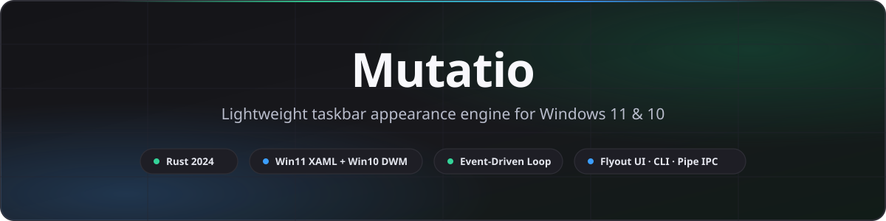
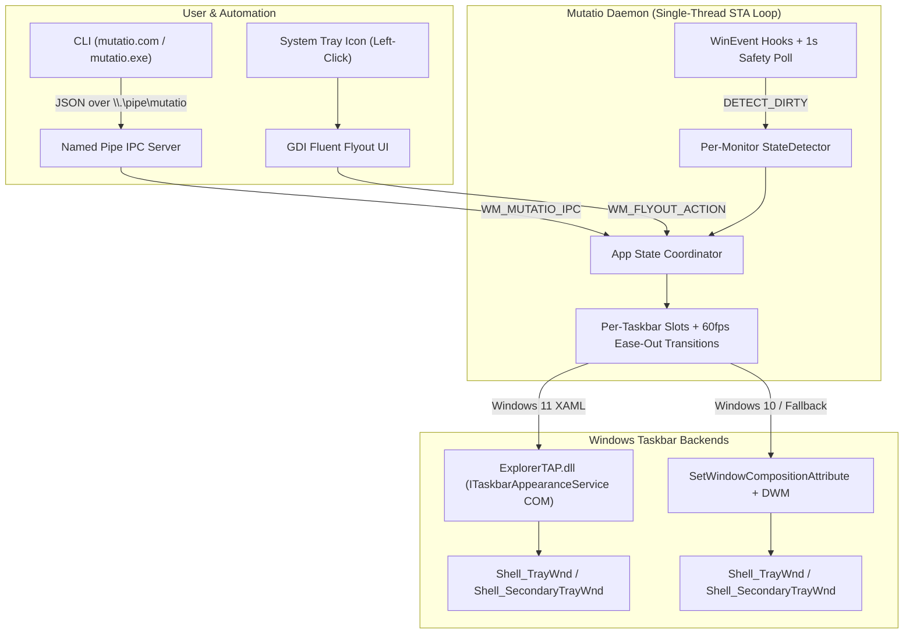

<p align="center">
  
</p>

<h1 align="center">Mutatio</h1>

<p align="center">
  Lightweight taskbar appearance engine for Windows 11 and 10, built in Rust.
</p>

<p align="center">
  <a href="https://github.com/projectGloria/Mutatio/actions/workflows/ci.yml"></a>
  <a href="Cargo.toml"></a>
  
  
  <a href="LICENSE"></a>
</p>

<p align="center">
  
</p>

<p align="center">
  <a href="#features">Features</a> ·
  <a href="#how-it-works">How It Works</a> ·
  <a href="#installation">Installation</a> ·
  <a href="#usage">Usage</a> ·
  <a href="#configuration">Configuration</a> ·
  <a href="#building-from-source">Building from Source</a> ·
  <a href="#license--credits">License &amp; Credits</a>
</p>

---

**Mutatio** (Latin: *change, transformation*) is a Windows 10/11 (`x86_64`) taskbar appearance daemon written in Rust (`windows` 0.62.2). It runs as a single-instance background tray app with an event-driven main loop, per-monitor state detection, smooth color transitions, a native dark flyout UI, and a CLI/Named Pipe IPC interface. On Windows 11 it embeds and injects TranslucentTB's `ExplorerTAP.dll` to drive `ITaskbarAppearanceService`; on Windows 10 (or ExplorerPatcher) it falls back to `SetWindowCompositionAttribute` and DWM attributes.

## Features

- **Five appearance presets & custom tinting**: Switch between `clear` (transparent), `blur` (Aero glass), `acrylic` (Fluent blur), `opaque` (solid black), and `normal` (Windows stock), pick from 6 quick-tint swatches in the flyout, or pass any `#RRGGBB` / `#RRGGBBAA` hex color over the CLI or IPC.
- **Per-monitor dynamic detection**: Tracks primary (`Shell_TrayWnd`) and secondary (`Shell_SecondaryTrayWnd`) taskbars independently across desktop, visible window, maximized window, Start menu (`StartMenuExperienceHost.exe`), and Search (`SearchHost.exe`) states.
- **Event-driven main loop**: Uses out-of-context WinEvent hooks coalesced inside `MsgWaitForMultipleObjectsEx` (with a 1 s safety poll and 16 ms animation ticks only while a transition is active) instead of continuous polling.
- **Smooth transitions & automatic safeguards**: 60fps ease-out cubic color interpolation (180 ms default), automatic stock taskbar restoration during fullscreen apps/games (`game_mode_pause`) and Windows Battery Saver (`battery_saver_fallback`), plus automatic reconnection when `explorer.exe` restarts (`TaskbarCreated`).
- **Native Fluent Dark Flyout UI**: Custom-painted, Per-Monitor DPI v2 aware GDI popup (`360×552` logical px) opened by left-clicking the tray icon and dismissed by clicking outside or pressing `Esc`. Includes preset cards, tint swatches, automation toggles, a live status banner, and `Config JSON`, `Restart Shell`, and `Exit` actions.
- **Dual-binary CLI & Named Pipe IPC**: Ships a console front-end (`mutatio.com`) alongside the windowless GUI daemon (`mutatio.exe`). Typing `mutatio` in PowerShell or cmd resolves `.com` first so output prints synchronously while communicating with the daemon over `\\.\pipe\mutatio`.

<!-- TODO: add screenshot of the Fluent Dark Flyout UI at docs/assets/flyout.png -->

## How It Works



All daemon state lives on the main STA thread inside an `App` coordinator that manages one `Slot` per detected taskbar. On startup, `assets/ExplorerTAP.dll` is extracted to `%LOCALAPPDATA%\Mutatio\` (only when its bytes differ) and injected into `explorer.exe` for Windows 11 XAML taskbars; if injection is unavailable, Mutatio automatically falls back to Win32 composition attributes. If `explorer.exe` restarts or the COM proxy disconnects, Mutatio retries reconnection for 15 seconds.

## Installation

### Requirements

- Windows 10 or Windows 11 (`x86_64`)

### Installer

1. Download `Mutatio-Setup-1.0.0.exe` from the [GitHub Releases](https://github.com/projectGloria/Mutatio/releases) page (or build it locally with `installer\build.ps1`).
2. Run the installer. It installs per-user by default (no administrator privileges required; you can optionally choose a machine-wide install).
3. During setup you can choose to:
   - Start Mutatio when you sign in to Windows
   - Add Mutatio to `PATH` so `mutatio` commands work from any terminal
   - Create a desktop shortcut

Uninstalling runs `mutatio.exe --quit` to restore your stock taskbar before removing files. Your configuration in `%APPDATA%\Mutatio\config.json` is kept.

## Usage

### System Tray & Flyout UI

Launch Mutatio from the Start menu or run `mutatio` in a terminal to start the background daemon:

- **Left-click** the tray icon to toggle the Flyout UI.
- **Click outside** or press **Esc** to close the flyout. (Right-clicking the tray icon does nothing.)
- Selecting a preset card or tint swatch applies a forced override until you re-enable **Dynamic Auto-Detect** or run `mutatio --toggle`.

### Command Line Interface

Type `mutatio` without an extension so Windows resolves the console wrapper (`mutatio.com`) ahead of `mutatio.exe`. If the daemon is not running yet, passing a preset flag (`--clear`, `--blur`, `--acrylic`, `--opaque`, `--normal`) starts it in the background with that preset.

```powershell
# Apply a preset
mutatio --clear
mutatio --blur
mutatio --acrylic
mutatio --opaque
mutatio --normal

# Apply a custom RGBA or RGB hex tint
mutatio --color "#1E1E28C8"
mutatio --color "#0E7A4D"

# Toggle dynamic auto-detection on/off (also clears a forced preset)
mutatio --toggle

# Reload %APPDATA%\Mutatio\config.json from disk
mutatio --reload

# Inspect active mode, backend engine, and per-taskbar state
mutatio --status

# Stop the daemon cleanly and restore stock taskbars
mutatio --quit
```

Example output from `mutatio --status`:

```text
Mutatio v1.0.0 | mode: fixed | engine: Win11 XAML | 2 taskbar(s)
  taskbar 0: desktop -> clear #000000FF
  taskbar 1: desktop -> clear #000000FF
```

<details>
<summary>Named Pipe IPC protocol</summary>

Mutatio listens on `\\.\pipe\mutatio` in message mode with `PIPE_REJECT_REMOTE_CLIENTS` and a current-user-only DACL. Each connection sends one serde-tagged JSON request and receives one JSON response:

```json
{"action":"set_state","payload":"blur"}
```

Supported actions:
- `{"action":"set_state","payload":"clear"|"blur"|"acrylic"|"opaque"|"normal"}`
- `{"action":"set_color","payload":{"r":14,"g":122,"b":77,"a":220}}`
- `{"action":"toggle_dynamic"}`
- `{"action":"reload"}`
- `{"action":"status"}`
- `{"action":"quit"}`

</details>

## Configuration

Configuration is stored at `%APPDATA%\Mutatio\config.json` (and diagnostic logs at `%LOCALAPPDATA%\Mutatio\mutatio.log`). Missing keys fall back to defaults, writes are atomic (temp file + rename), and an unparsable file is backed up to `config.json.bak` before defaults are restored.

<details>
<summary>Default <code>config.json</code></summary>

```json
{
  "desktop": {
    "state": "clear",
    "color": { "r": 0, "g": 0, "b": 0, "a": 0 },
    "show_line": false
  },
  "visible_window": {
    "state": "blur",
    "color": { "r": 20, "g": 20, "b": 20, "a": 120 },
    "show_line": false
  },
  "maximized_window": {
    "state": "opaque",
    "color": { "r": 0, "g": 0, "b": 0, "a": 255 },
    "show_line": false
  },
  "start_opened": {
    "state": "acrylic",
    "color": { "r": 30, "g": 30, "b": 30, "a": 180 },
    "show_line": false
  },
  "search_opened": {
    "state": "acrylic",
    "color": { "r": 30, "g": 30, "b": 30, "a": 180 },
    "show_line": false
  },
  "dynamic_modes_enabled": true,
  "smooth_transitions": true,
  "transition_duration_ms": 180,
  "game_mode_pause": true,
  "battery_saver_fallback": true
}
```

</details>

## Building from Source

### Prerequisites

- [Rust](https://rustup.rs/) with edition 2024 support (Rust 1.85+ stable)
- Windows 10 or Windows 11 (`x86_64`)
- Windows SDK (`rc.exe`, used by `build.rs` via `embed-resource` to embed the icon and `VERSIONINFO`)
- Optional: [Inno Setup 6](https://jrsoftware.org/isinfo.php) (`winget install JRSoftware.InnoSetup`) to build the Windows installer

### Steps

1. Clone the repository:
   ```powershell
   git clone https://github.com/projectGloria/Mutatio.git
   cd Mutatio
   ```
2. Build the release binaries:
   ```powershell
   cargo build --release
   ```
   Output:
   - `target\release\mutatio.exe` — windowless tray daemon (GUI subsystem)
   - `target\release\mutatio-cli.exe` — console CLI wrapper (installed as `mutatio.com`)
3. Run tests and lints:
   ```powershell
   cargo test
   cargo clippy --all-targets
   ```
4. Build the installer (optional):
   ```powershell
   powershell -ExecutionPolicy Bypass -File installer\build.ps1
   ```
   Output: `dist\Mutatio-Setup-1.0.0.exe` (version is read from `Cargo.toml`).

## Contributing

Pull requests and issue reports are welcome. Before opening a PR:

- Run `cargo test` and `cargo clippy --all-targets` and keep them warning-free.
- Verify any taskbar, flyout, or IPC changes manually against a live Windows desktop session (quit any installed Mutatio instance first via `mutatio --quit`, and restore `%APPDATA%\Mutatio\config.json` if you toggled settings during testing).

## License & Credits

- Core Mutatio daemon, CLI wrapper, and GDI flyout UI are licensed under the [MIT License](LICENSE).
- The embedded `assets/ExplorerTAP.dll` shell bridge is derived from [TranslucentTB](https://github.com/TranslucentTB/TranslucentTB) and licensed under the [GNU General Public License v3.0 (GPL-3.0)](THIRD_PARTY_LICENSES.md). See [THIRD_PARTY_LICENSES.md](THIRD_PARTY_LICENSES.md) for full license terms and attribution.
- Built with Microsoft's [`windows-rs`](https://github.com/microsoft/windows-rs) (`windows` 0.62.2), `serde`, `serde_json`, and `embed-resource`.
