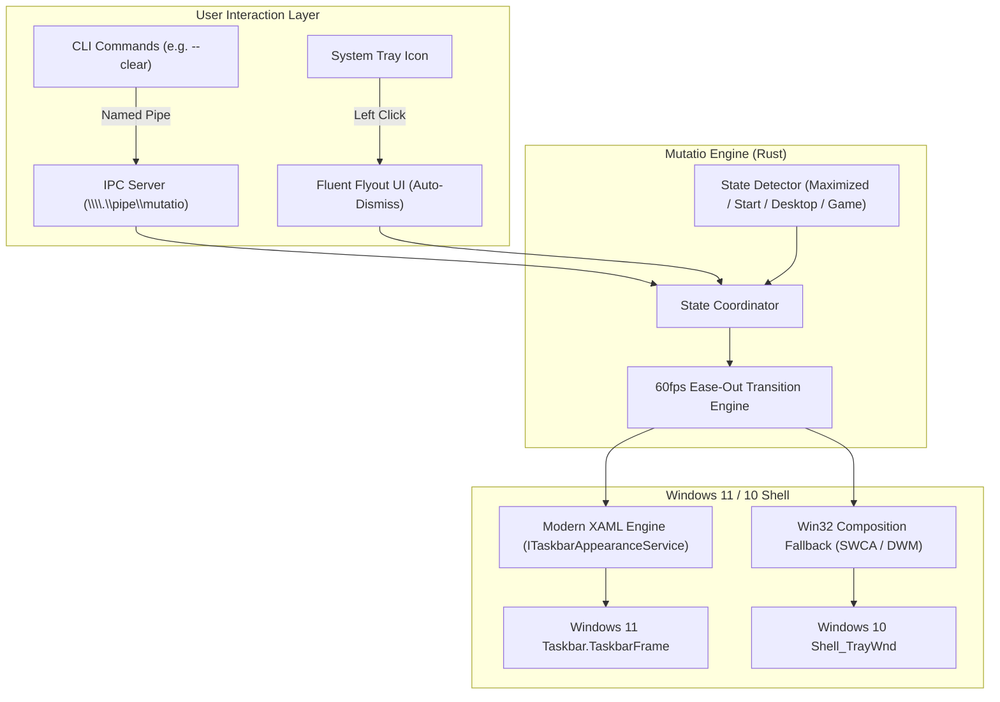

# Mutatio ⚡

<p align="center">
  <strong>Next-Generation, Ultra-Lightweight Taskbar Appearance Engine for Windows 11 & 10</strong>
  <br />
  <em>Core daemon and UI built in 100% Rust, interfacing with Windows Modern Shell via embedded TAP bridge. Sub-15 MB RAM • 0% Idle CPU • Windows 11 (21H2–24H2) Support</em>
</p>

<p align="center">
  
  
  
  
  
</p>

---

## 📖 About Mutatio

**Mutatio** (Latin: *change, transformation*) is a blazing-fast, crash-resistant, modern taskbar appearance engine for Windows 11 (including Build 26100 / 24H2) and Windows 10. 

Mutatio provides a lightweight (<15 MB RAM), self-contained solution with smooth 60fps fade animations, zero idle CPU wakeups, an integrated Fluent Dark Flyout UI, and full CLI/IPC automation, using in-process shell hooks (via ExplorerTAP) on Windows 11 and composition attributes on Windows 10.

---

## ⚡ Highlights & Comparison

| Feature | TranslucentTB (Upstream) | **Mutatio (This Project)** |
| :--- | :--- | :--- |
| **Language & Safety** | C++ / C++/WinRT / vcpkg | **100% Rust** (`windows-rs` 0.62) + embedded TAP bridge |
| **Memory Footprint** | ~35 MB – 95 MB RAM | **~13 MB RAM** (sub-15 MB) |
| **Idle CPU Usage** | Periodic polling wakeups | **0.0% CPU** (at idle via event-driven WinEvent hooks) |
| **Win11 24H2 Support** | Often crashes or fails on XAML `BackgroundFill` | **Native COM `ITaskbarAppearanceService`** |
| **Smooth Transitions** | ❌ Snappy/abrupt state switching | ✅ **60fps Ease-Out Cubic Animations** |
| **Fullscreen Game Mode** | ❌ Keeps running & polling | ✅ **Auto-Sleep in Fullscreen 3D Games** (Game Auto-Pause) |
| **User Interface** | Heavy multi-megabyte XAML Island | ✅ **Native Fluent Dark Flyout UI** (Auto-dismiss, zero latency) |
| **CLI & IPC Automation** | ❌ None (GUI only) | ✅ **Built-in CLI & Named Pipe IPC Server** |
| **Packaging** | Installer + multiple loose DLLs | ✅ **Self-contained distribution** |

---

## 🛠️ Architecture



---

## ✨ Features

- **Integrated Fluent Dark Flyout UI**: Left-click the tray icon to open an ultra-responsive, beautiful settings panel anchored right above your taskbar. Auto-dismisses when you click away. Right-clicking does nothing.
- **5 Appearance Presets**:
  - **Clear**: 100% crystal-clear taskbar transparency.
  - **Blur**: Aero glass frosted effect.
  - **Acrylic**: Windows 11 Fluent Acrylic material with depth.
  - **Opaque Black**: Pure solid pitch-black (`#000000`, 100% alpha) taskbar.
  - **Windows Default**: Cleanly restores stock Windows taskbar styling.
- **Smart Dynamic Automation**:
  - Automatically adapts appearance when windows maximize, minimize, or when the Start Menu or Search flyout opens.
- **Smooth Animated Transitions**:
  - Linear color interpolation with ease-out cubic curve (60fps ticks during transitions, zero CPU when idle).
- **Fullscreen Game Auto-Sleep**:
  - Detects exclusive fullscreen DirectX/Vulkan games and puts the engine to sleep to eliminate frame drops and avoid anti-cheat flags.
- **Named Pipe IPC & CLI**:
  - Script or bind any state to shortcuts, AutoHotkey, or Stream Deck.

---

## 🚀 Quick Start

### 1. Install
Download and run `Mutatio-Setup-<version>.exe`. It installs per-user (no admin rights needed) and offers to:
- start Mutatio when you sign in,
- add Mutatio to your `PATH` for the CLI,
- create a desktop shortcut.

Uninstalling stops Mutatio and restores the stock taskbar. Your settings in `%APPDATA%\Mutatio` are kept.

### 2. Run the Background Daemon
Launch Mutatio from the Start menu, or run `mutatio` in a terminal. It runs in the system tray without a console window:
- **Left-click** the tray icon: Opens the Flyout UI.
- **Click outside / Esc**: Closes the UI.

### 3. Command Line Interface (CLI)
You can control a running Mutatio instance or launch it with a preset.
Type `mutatio` without an extension: Windows picks the console front-end `mutatio.com` over the windowless `mutatio.exe`, so output prints normally in PowerShell and cmd.

```powershell
# Set taskbar to 100% transparent
mutatio --clear

# Set taskbar to solid pitch black
mutatio --opaque

# Set taskbar to Fluent Acrylic
mutatio --acrylic

# Set taskbar to Aero Blur
mutatio --blur

# Set taskbar to a custom HEX color
mutatio --color "#FF000000"

# Restore default Windows appearance
mutatio --normal

# Toggle dynamic auto-detection on/off (also clears a forced preset)
mutatio --toggle

# Reload configuration from disk
mutatio --reload

# Show daemon status (mode, engine, per-taskbar state)
mutatio --status

# Exit Mutatio cleanly and restore taskbars
mutatio --quit
```

---

## ⚙️ Configuration (`config.json`)

Configuration is stored at `%APPDATA%\Mutatio\config.json`:

```json
{
  "desktop": {
    "state": "clear",
    "color": { "r": 0, "g": 0, "b": 0, "a": 0 },
    "show_line": false
  },
  "visible_window": {
    "state": "blur",
    "color": { "r": 20, "g": 20, "b": 20, "a": 120 },
    "show_line": false
  },
  "maximized_window": {
    "state": "opaque",
    "color": { "r": 0, "g": 0, "b": 0, "a": 255 },
    "show_line": false
  },
  "start_opened": {
    "state": "acrylic",
    "color": { "r": 30, "g": 30, "b": 30, "a": 180 },
    "show_line": false
  },
  "search_opened": {
    "state": "acrylic",
    "color": { "r": 30, "g": 30, "b": 30, "a": 180 },
    "show_line": false
  },
  "dynamic_modes_enabled": true,
  "smooth_transitions": true,
  "transition_duration_ms": 180,
  "game_mode_pause": true,
  "battery_saver_fallback": true
}
```

---

## 🔨 Building from Source

### Prerequisites
- [Rust](https://rustup.rs/) (1.80+ or latest stable)
- Windows 10 or 11 (x86_64)

### Build Steps
```powershell
git clone https://github.com/projectGloria/Mutatio.git
cd Mutatio

# Release binaries (icon + version info are embedded by build.rs; needs the Windows SDK's rc.exe)
cargo build --release
```
This produces `target/release/mutatio.exe` (tray daemon) and `target/release/mutatio-cli.exe` (console CLI, shipped as `mutatio.com`).

### Building the Installer
Requires [Inno Setup 6](https://jrsoftware.org/isinfo.php) (`winget install JRSoftware.InnoSetup`):
```powershell
powershell -ExecutionPolicy Bypass -File installer\build.ps1
```
Output: `dist\Mutatio-Setup-<version>.exe`. The version is read from `Cargo.toml`.

---

## 📄 License & Credits

- Core Mutatio daemon and CLI licensed under the [MIT License](LICENSE).
- ExplorerTAP bridge derived from [TranslucentTB](https://github.com/TranslucentTB/TranslucentTB) under the [GPL-3.0 License](THIRD_PARTY_LICENSES.md). See [THIRD_PARTY_LICENSES.md](THIRD_PARTY_LICENSES.md) for full attributions and license details.
- Powered by the [`windows-rs`](https://github.com/microsoft/windows-rs) crate by Microsoft.
